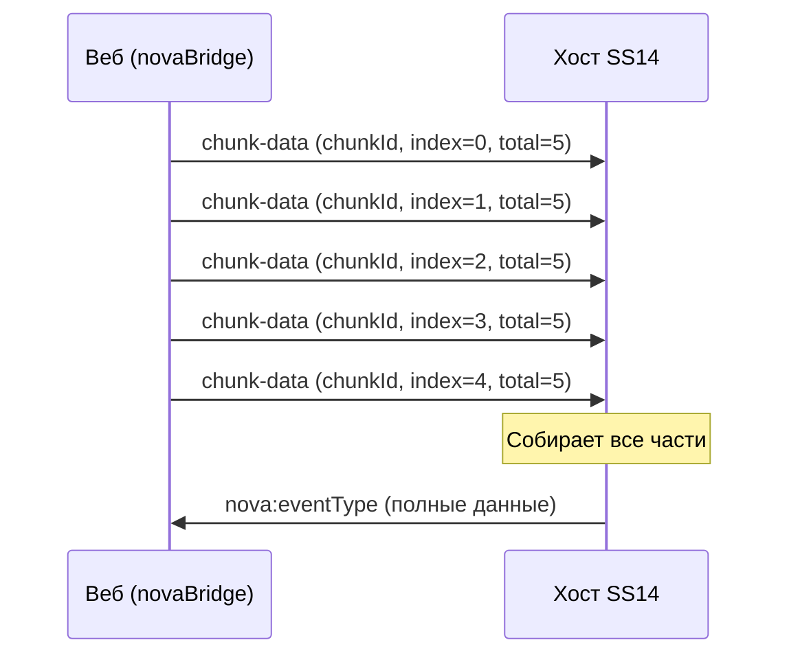

# NovaBridge — протокол связи с хостом

**NovaBridge** (`src/lib/novaBridge.ts`) — это Singleton-класс, реализующий двунаправленный протокол связи между веб-интерфейсом и нативным хостом SS14 (CEF/WebView).

## Общая концепция

Веб-интерфейс не может напрямую вызывать функции игрового клиента. NovaBridge решает эту проблему через механизм **CustomEvent + hidden iframe**:

```
Веб (JS)                    iframe (ev://)          Хост (C#)
──────────────────────────────────────────────────────────────
novaBridge.invoke()  →  <iframe src="ev://...">  →  Обработчик
                     ←  nova:complete (event)    ←  Ответ
```

## API NovaBridge

### `novaBridge.invoke(eventType, data)`

Отправляет запрос к хосту и ожидает ответ.

```typescript
const result = await novaBridge.invoke('get-player-data', { userId: 123 });
console.log(result); // Данные от хоста
```

- `eventType: string` — тип события
- `data: any` — произвольные данные (сериализуются в JSON)
- Возвращает `Promise<any>` — ответ от хоста
- Таймаут: 10 секунд (если ответ не пришёл — reject с 'Request timeout')

### `novaBridge.emit(eventType, data)`

Отправляет событие хосту без ожидания ответа (fire-and-forget).

```typescript
novaBridge.emit('ui-interaction', { button: 'click', x: 100, y: 200 });
```

- Если страница ещё не готова (`page-ready` не отправлен), событие ставится в очередь
- После готовности все накопленные события отправляются

### `novaBridge.subscribe(eventType, handler)`

Подписывается на события от хоста.

```typescript
const unsubscribe = novaBridge.subscribe('chat-message', (data) => {
    console.log('Новое сообщение:', data.text);
});

// Отписка
unsubscribe();
```

- `handler: (data: any) => void`
- Возвращает функцию для отписки

## Детали реализации

### 1. Протокол `ev://`

Для отправки данных хосту создаётся скрытый iframe с URL вида:

```
ev://<eventType>?requestId=<id>&data=<base64-encoded-JSON>
```

Хост перехватывает навигацию iframe'а по этому протоколу и обрабатывает запрос.

### 2. Кодирование данных

Для безопасной передачи бинарных данных через URL используется `safeBtoa`/`safeAtob` — обёртки над `btoa`/`atob` с корректной обработкой Unicode:

```typescript
// Кодирование: UTF-8 → percent-encoding → base64
private safeBtoa(str: string): string {
    return btoa(encodeURIComponent(str).replace(/%([0-9A-F]{2})/g,
        (_, p1) => String.fromCharCode(parseInt(p1, 16)),
    ));
}

// Декодирование: base64 → percent-encoding → UTF-8
private safeAtob(str: string): string {
    return decodeURIComponent([...atob(str)]
        .map((c) => '%' + c.charCodeAt(0).toString(16).padStart(2, '0'))
        .join(''),
    );
}
```

### 3. Поток событий

Хост отвечает через CustomEvent на `window`:

| Событие | Назначение |
|---------|------------|
| `nova:complete` | Успешный ответ на запрос. Содержит `requestId` и `data` |
| `nova:error` | Ошибка выполнения запроса. Содержит `requestId` и сообщение |
| `nova:chunk-event` | Фрагмент входящего события (чанк) |
| `nova:response-chunk-init` | Инициализация фрагментированного ответа |
| `nova:response-chunk-data` | Фрагмент данных ответа |

### 4. Чанкование больших сообщений

Если JSON-данные превышают 1500 символов в base64, сообщение автоматически разбивается на части:

- **Исходящие** (`sendChunkedRequest`): большие запросы разбиваются на фрагменты по 1500 символов, каждый отправляется с задержкой 10 мс
- **Входящие** (`handleChunkEvent`, `handleResponseChunkInit`, `handleResponseChunkData`): фрагменты собираются в буфере, после получения всех частей собирается полное сообщение



### 5. Жизненный цикл страницы

При загрузке страницы:

1. Если DOM загружается — ждёт `DOMContentLoaded`
2. Отправляет событие `page-ready` хосту с размерами окна (из мета-тегов `nova-window-width`/`nova-window-height`)
3. Устанавливает флаг `isPageReady = true`
4. Отправляет все накопленные в очереди события

```html
<meta name="nova-window-width" content="800">
<meta name="nova-window-height" content="600">
```

### 6. Глобальные типы

В `src/global.d.ts` объявлен тип для API файловой системы, доступной через `window.fs` (предоставляется хостом):

```typescript
declare global {
    interface Window {
        fs: {
            readFile(path: string, options?: { encoding?: string }): Promise<Uint8Array | string>
        }
    }
}
```
